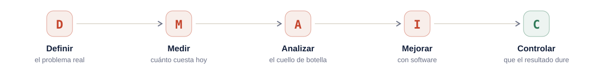

<a href="https://sebastian-cespedes.netlify.app">
  <picture>
    <source media="(prefers-color-scheme: dark)" srcset="assets/portada-dark.svg">
    
  </picture>
</a>

  
  
  

## Sobre mí

Desarrollador de software full-stack con foco en **backend y automatización de procesos**. Antes de escribir código mido dónde se pierde el tiempo, y después construyo el software que lo elimina.

- 💼 **Desarrollador de Software en Grupo Unicomer** (práctica profesional): proyecto para el área de Operaciones con Angular, Java y PostgreSQL.
- 🏗️ **Comercializadora Caces de Oro** (2023 – 2025): soluciones web a medida, CI/CD con GitLab y Docker.
- 📐 **Lean Six Sigma Green Belt**: priorizo los flujos de mayor impacto antes de automatizarlos.
- 🎓 **Bachillerato en Ingeniería de Software**, Universidad Técnica Nacional (2022 – 2026).
- 🔎 **Abierto a oportunidades** como desarrollador full-stack o backend.

## Impacto

<picture>
  <source media="(prefers-color-scheme: dark)" srcset="assets/impacto-dark.svg">
  99 % disponibilidad, 40 % más rápido detectando errores de precio, 4+ h/mes de conciliación eliminadas" src="assets/impacto-light.svg" width="100%">
</picture>

## Cómo trabajo

Cada proyecto sigue el ciclo **DMAIC** de Lean Six Sigma, para que el software ataque el cuello de botella correcto y el resultado se pueda medir.

<picture>
  <source media="(prefers-color-scheme: dark)" srcset="assets/dmaic-dark.svg">
  
</picture>

## Proyectos destacados

<table>
  <tr>
    <td width="50%" valign="top">
      <h3>Facturación electrónica automatizada</h3>
      
Procesamiento automático de comprobantes electrónicos de Hacienda, con dashboards y alertas.

      
✅ <b>100 % automática · −4 h/mes de conciliación</b>

      
<code>Python</code> <code>lxml</code> <code>XSLT</code> <code>watchdog</code> <code>Google Sheets API</code>

      
<a href="https://github.com/CespSebas/panel-facturas-carnices">Código</a> · <a href="https://sebastian-cespedes.netlify.app/#caso-facturacion">Caso DMAIC</a>

    </td>
    <td width="50%" valign="top">
      <h3>Sistema de gestión para emprendimiento</h3>
      
Aplicación full-stack con catálogo, pedidos, reseñas y panel administrativo.

      
✅ <b>Catálogo, pedidos y reseñas en un solo sistema</b>

      
<code>Angular</code> <code>Node.js</code> <code>Express</code> <code>Prisma</code> <code>MySQL</code>

      
<a href="https://github.com/CespSebas/carnices-showcase">Código</a> · <a href="https://sebastian-cespedes.netlify.app/#caso-carnices">Caso DMAIC</a>

    </td>
  </tr>
  <tr>
    <td width="50%" valign="top">
      <h3>Motor de reglas de promociones</h3>
      
Reemplazó un proceso manual en hojas de cálculo con reglas validadas y reportes de margen.

      
✅ <b>Errores de precio detectados 40 % más rápido</b>

      
<code>C#</code> <code>.NET 4.8</code> <code>SQL Server</code> <code>Repository</code> <code>Unit of Work</code>

      
🔒 Código privado · <a href="https://sebastian-cespedes.netlify.app/#caso-promociones">Caso DMAIC</a>

    </td>
    <td width="50%" valign="top">
      <h3>E-commerce con panel multi-rol</h3>
      
Portal con autenticación JWT multi-rol y arquitectura modular en NestJS.

      
✅ <b>Despliegue de horas a menos de 10 minutos</b>

      
<code>Angular</code> <code>NestJS</code> <code>Prisma</code> <code>JWT</code> <code>Docker</code>

      
🔒 Código privado · <a href="https://sebastian-cespedes.netlify.app/#caso-ecommerce">Caso DMAIC</a>

    </td>
  </tr>
</table>

📂 **[Índice completo de proyectos](https://github.com/CespSebas/repo_personal_proyectos_concluidos)**: incluye la App de Operaciones (Unicomer), el sitio de Comercializadora Caces de Oro y un análisis de datos retail, cada uno con su ficha.

## Stack

<table>
  <tr>
    <td><b>Lenguajes</b></td>
    <td>
      
      
      
      
      
      
    </td>
  </tr>
  <tr>
    <td><b>Frontend</b></td>
    <td>
      
      
      
      
      
    </td>
  </tr>
  <tr>
    <td><b>Backend</b></td>
    <td>
      
      
      
      
      
      
    </td>
  </tr>
  <tr>
    <td><b>Datos</b></td>
    <td>
      
      
      
      
      
      
    </td>
  </tr>
  <tr>
    <td><b>DevOps</b></td>
    <td>
      
      
      
      
      
      
    </td>
  </tr>
  <tr>
    <td><b>Automatización</b></td>
    <td>
      
      
      
    </td>
  </tr>
  <tr>
    <td><b>Métodos</b></td>
    <td>
      
      
      
    </td>
  </tr>
</table>

## Certificaciones

**Lean Six Sigma Green Belt** (MoreSteam, 2025) · **Google Data Analytics Professional Certificate** (2025) · **Data Science Essentials with Python** (Cisco, 2026) · **JavaScript Essentials 1 y 2** (Cisco, 2024 – 2025)

---

  <b>¿Tu equipo necesita convertir procesos en software?</b> 
  <a href="https://sebastian-cespedes.netlify.app">Portafolio</a> ·
  <a href="https://www.linkedin.com/in/sebasti%C3%A1n-andr%C3%A9s-c%C3%A9spedes-quesada-52971a2ab/">LinkedIn</a> ·
  <a href="mailto:sc163876@gmail.com">sc163876@gmail.com</a> · Grecia, Costa Rica

